# Documento de UX do MVP — Rotinaê

> **Versão:** 0.2.1  
> **Status:** Base para pesquisa, prototipação e validação  
> **Data:** 02/08/2026  
> **Responsável:** Dante — UX  
> **Fontes:** Visão v0.4.0, Regras de Negócio v0.2.0, RF v0.1.0, RNF v0.1.0, Histórias v0.1.0 e Lean Inception v0.3.0

> **Linguagem visual:** cores, tipografia, componentes, ícones e padrões responsivos são definidos no `DESIGN_SYSTEM_MVP.md` v0.2.0.

## 1. Propósito

Traduzir a baseline do MVP em uma experiência coerente, acessível e rastreável para os dois perfis vigentes: **Prestador** e **Cliente**. Este documento orienta pesquisa, arquitetura da informação, protótipos, conteúdo, testes de usabilidade e critérios de implementação. Não cria funcionalidades fora dos requisitos aprovados.

## 2. Objetivos e princípios de UX

### Objetivos

- reduzir o esforço para organizar e consultar atendimentos;
- tornar disponibilidade, vínculo, pacote, saldo e plano compreensíveis antes da confirmação;
- oferecer previsibilidade sobre efeitos de ações críticas;
- manter continuidade entre smartphone, tablet e computador;
- separar claramente observação compartilhada, evolução técnica e comunicação automática;
- permitir que o usuário reconheça o contexto do prestador ativo e o estado da operação.

### Princípios

1. **Contexto sempre visível:** prestador selecionado, data, fuso, status, pacote e plano aparecem onde influenciam uma decisão.
2. **Prevenir antes de corrigir:** horários inválidos não são oferecidos; conflitos, cota e saldo são validados antes da confirmação.
3. **Consequências explícitas:** cancelamento, falta, consumo de saldo, revogação e downgrade exigem resumo do efeito.
4. **Progressão simples:** revelar apenas campos necessários em cada etapa, com resumo final.
5. **Histórico confiável:** estados e registros preservados são apresentados como linha do tempo, sem simular chat.
6. **Privacidade por padrão:** evolução é privada até compartilhamento explícito; dados de outro vínculo nunca aparecem no contexto atual.
7. **Canal não é operação:** falha de mensagem não comunica falha no agendamento ou cancelamento.
8. **Acessibilidade desde o fluxo:** linguagem direta, foco previsível, rótulos persistentes e estados não dependentes apenas de cor.

## 3. Personas primárias

Personas são hipóteses comportamentais, não segmentações definitivas. Devem ser validadas em pesquisa.

### 3.1 Prestador autônomo — “Paula”

- **Contexto:** atende em horários variáveis, alterna entre celular em campo e computador para organizar a semana; inicialmente representa o adestrador, usando termos genéricos no produto.
- **Objetivos:** evitar conflito; acompanhar clientes e animais; controlar pacotes, recebimentos e evolução; reduzir lembretes manuais.
- **Dores:** dados espalhados; alterações por mensagens; dúvida sobre saldo; registros feitos tarde; baixa visão de recebimentos.
- **Necessidades:** visão diária rápida, criação eficiente, confirmação clara, histórico auditável e ações críticas protegidas.
- **Limitações contextuais:** uso com uma mão, interrupções, conexão instável e pouco tempo entre atendimentos.
- **Critério de valor:** concluir a rotina central sem voltar a agenda, planilha e anotações paralelas.

### 3.2 Cliente final — “Rafael”

- **Contexto:** acessa principalmente pelo celular, pode contratar mais de um prestador e consulta a plataforma de forma eventual.
- **Objetivos:** vincular-se com segurança; encontrar horário; agendar, remarcar ou cancelar; consultar pacote e informações permitidas.
- **Dores:** informações perdidas em conversas, dúvida sobre confirmação, dificuldade para lembrar saldo e validade.
- **Necessidades:** fluxo curto, contexto do prestador inequívoco, linguagem não técnica, feedback imediato e lembretes controláveis.
- **Limitações contextuais:** baixa familiaridade com regras de agenda; não conhece conceitos internos como tenant, reserva ou atomicidade.
- **Critério de valor:** saber rapidamente “com quem”, “quando”, “qual serviço” e “o que acontecerá”.

### 3.3 Cenários de pesquisa prioritários

- prestador iniciante e prestador com agenda cheia;
- cliente com um e com vários prestadores;
- uso em deslocamento e uso administrativo no computador;
- usuário com baixa visão, navegação por teclado ou leitor de tela;
- falha de conexão durante confirmação e conflito simultâneo pela última vaga/saldo.

## 4. Mapa de stakeholders

| Grupo | Interesse | Influência | Necessidade de UX |
|---|---|---:|---|
| Prestador | Operação, receita, retenção | Alta | Eficiência, confiança e visão consolidada |
| Cliente | Conveniência e transparência | Alta | Simplicidade, segurança e autonomia |
| Produto/negócio Rotinaê | Ativação, retenção e conversão | Alta | Métricas sem padrões manipulativos |
| Suporte/operação | Resolver incidentes | Média | Estados e correlação auditáveis, sem expor conteúdo sensível |
| Jurídico/DPO | LGPD, termos e consentimento | Alta | Aceites separados e revogação compreensível |
| Provedores externos | Comunicação, cobrança, infraestrutura | Média | Falhas desacopladas e mensagens de contingência |
| Desenvolvimento/QA | Implementação verificável | Alta | Fluxos, estados, permissões e rastreabilidade explícitos |

Equipe de prestadores, administradores completos e marketplace não são personas do MVP.

## 5. Arquitetura da informação

### Prestador

- **Início:** próximos atendimentos, pendências de vínculo, alertas de plano e atalhos.
- **Agenda:** calendário/lista, filtros, disponibilidade, criar atendimento.
- **Clientes:** carteira, detalhes, animais, histórico, documentos autorizados.
- **Serviços:** catálogo ativo/inativo.
- **Pacotes:** ativos/vencidos/cancelados, saldo e movimentações.
- **Financeiro:** recebimentos e resumo básico.
- **Comunicações:** preferências e estado de envios quando disponível.
- **Plano:** trial, cota, Premium, contratação/cancelamento.
- **Perfil e privacidade:** dados, código de vínculo, solicitações, consentimentos e direitos do titular.

### Cliente

- **Início:** próximos atendimentos, solicitações pendentes e contexto ativo.
- **Prestadores:** adicionar código, acompanhar pedidos, alternar e revogar vínculos.
- **Agenda:** próprios atendimentos e novo agendamento.
- **Pacotes:** próprios saldos, validade e histórico por prestador.
- **Perfil e privacidade:** dados, preferências, consentimentos e direitos do titular.

### Mapa de navegação

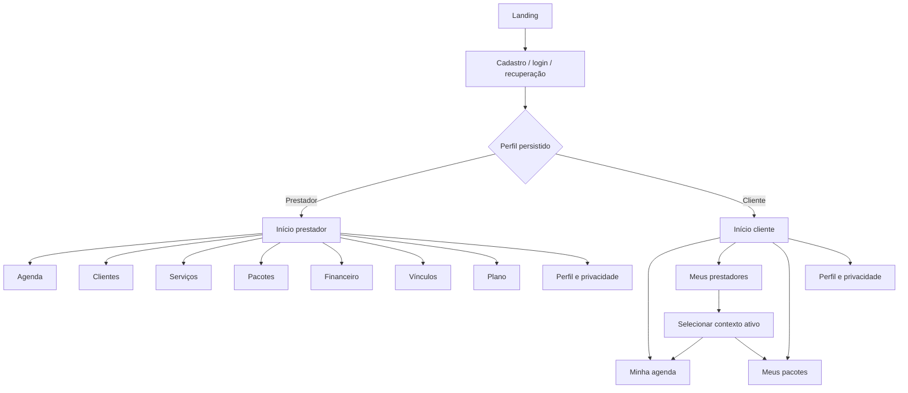

**Decisão de design a validar (DD-UX-001):** navegação inferior no mobile e lateral em telas amplas, mantendo nomes e hierarquia equivalentes.  
**Hipótese (H-UX-001):** “Início” centrado em próximos atendimentos e pendências reduz tempo até a ação principal.

## 6. Jornadas ponta a ponta

| Jornada | Gatilho | Etapas essenciais | Resultado | Riscos UX |
|---|---|---|---|---|
| Ativação do prestador | Primeiro cadastro | perfil → documentos legais → configuração → trial → código → disponibilidade/serviço | apto a operar | excesso de configuração inicial |
| Entrada do cliente | Código recebido | cadastro → perfil Cliente → aceites → código → pedido → espera/aprovação | vínculo Ativo | interpretar pedido como acesso imediato |
| Agendamento do cliente | Necessidade de horário | contexto → serviço → data/slot → pacote opcional → revisão → confirmar | Agendado | um dia útil, cota ou saldo pouco claros |
| Rotina do prestador | Preparar/realizar atendimento | agenda → detalhe → observação/evolução → concluir/falta | histórico e saldo atualizados | confundir observação com evolução |
| Gestão de pacote | Venda registrada externamente | criar pacote → vincular → reservar → consumir/liberar → consultar/ajustar | saldo rastreável | “saldo” sem decomposição |
| Controle financeiro | Valor devido | criar recebimento → atualizar status → filtrar/resumir | controle operacional | parecer pagamento processado |
| Transição de plano | Trial termina ou cobrança muda | aviso → comparar → contratar ou Gratuito → restrições | acesso coerente | medo de perda de dados |

## 7. Fluxos detalhados

### 7.1 Cadastro, perfil e primeiro acesso

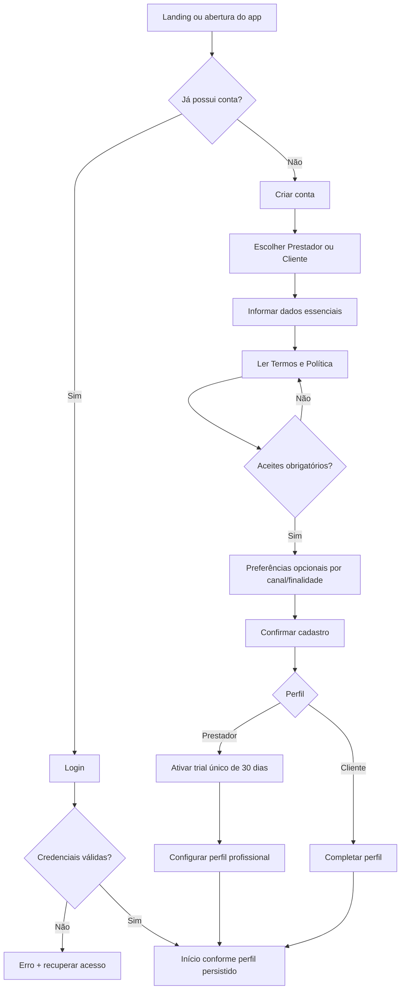

O cadastro define o perfil inicial. Depois, **Alternar perfil** permite criar o perfil ausente ou ativar um perfil já existente na mesma conta; a interface deve sempre indicar o contexto ativo e não misturar dados entre Cliente e Prestador. Esta regra substitui a antiga DD-UX-002 de perfil único.

### 7.2 Vínculo por código, aprovação e multi-prestador

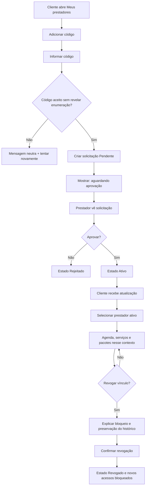

O seletor deve mostrar nome, status e contexto atual; dados de contextos diferentes não são combinados. Regenerar código invalida o anterior. Nunca exibir se o código pertence a alguém em mensagens de erro.

### 7.3 Agendamento pelo cliente

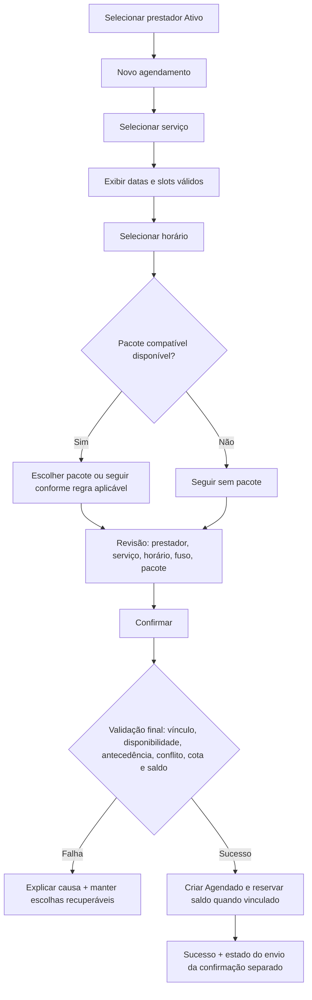

### 7.4 Agendamento pelo prestador

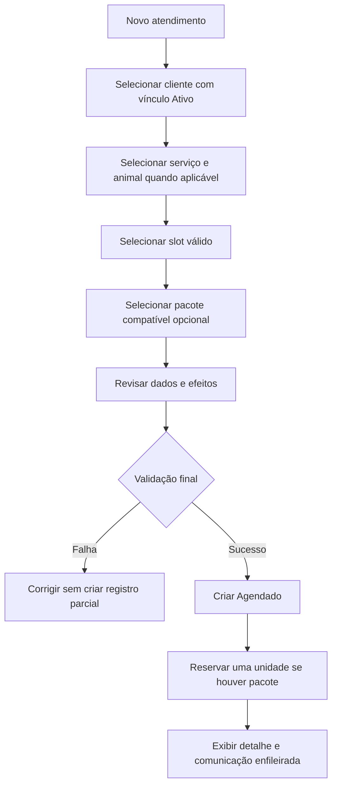

### 7.5 Recorrência atômica

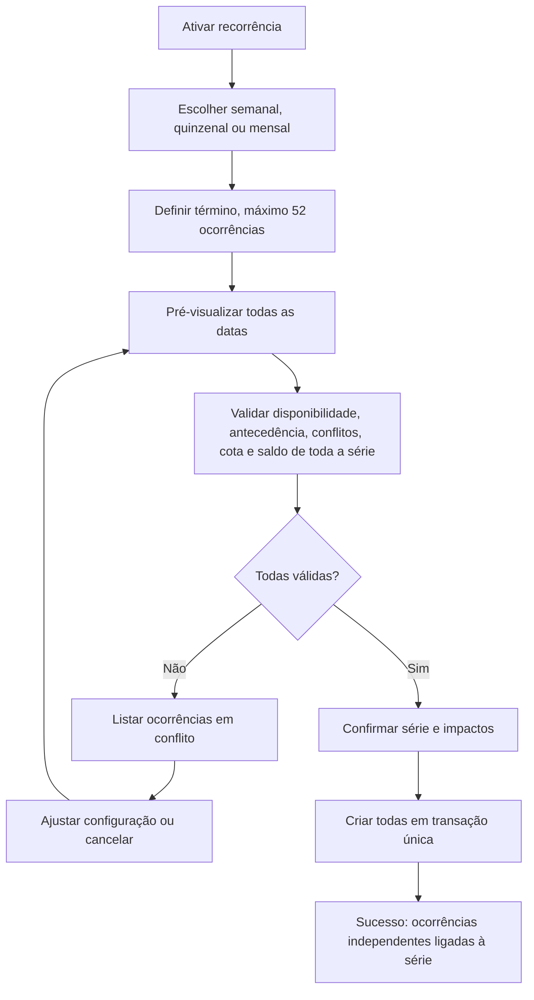

Não oferecer “criar apenas as válidas”, pois viola atomicidade. Alterações posteriores afetam uma ocorrência por vez no MVP.

### 7.6 Remarcação e cancelamento

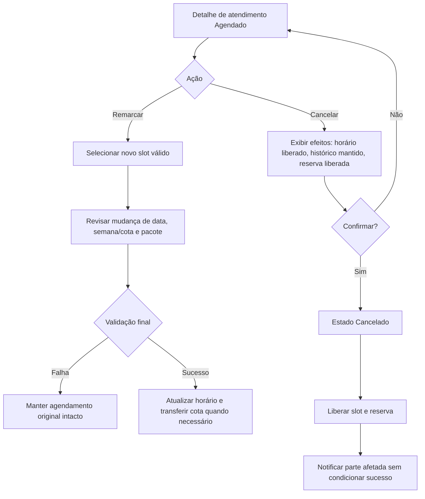

### 7.7 Conclusão e falta

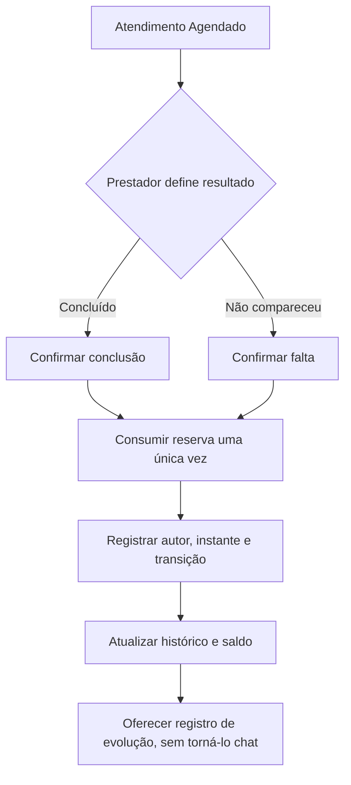

Cliente não conclui nem registra falta. Estados terminais não oferecem cancelamento.

### 7.8 Pacotes e saldo

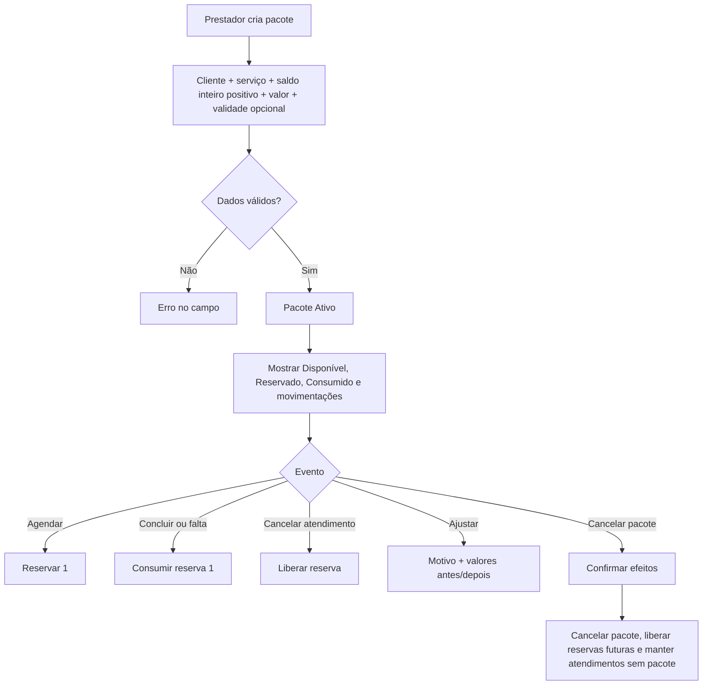

Exibir equação explicativa: **saldo disponível = saldo contratado/ajustado − consumido − reservado**, conforme implementação aprovada. Não usar apenas um número “saldo”.

### 7.9 Observações e evolução

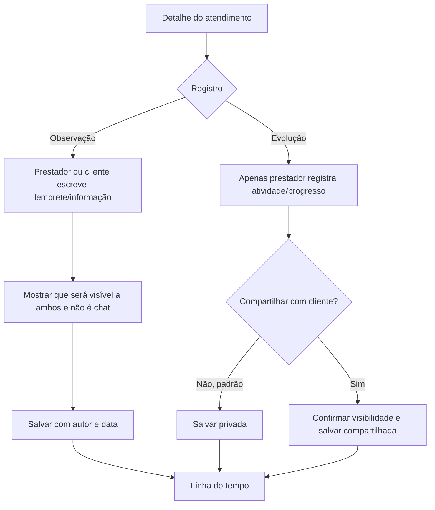

Edição/exclusão autorizada de observação deve informar que haverá auditoria. Anexos seguem permissão e validação próprias.

### 7.10 Financeiro básico

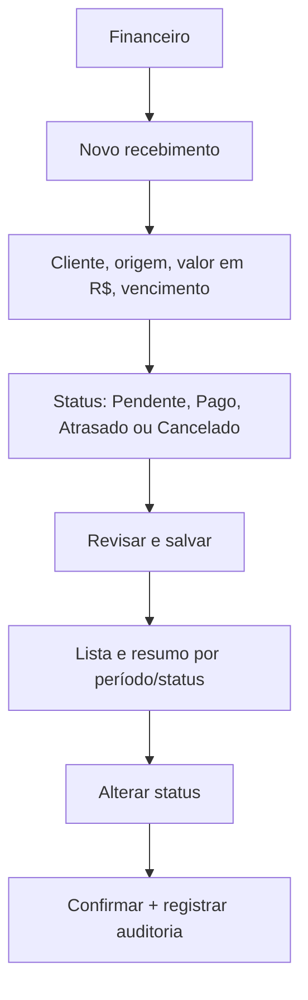

Mensagem persistente: “Controle manual; o Rotinaê não processa nem confirma pagamentos do serviço.” Não apresentar recibo bancário, parcelamento, comissão ou função fiscal.

### 7.11 Comunicação e consentimento

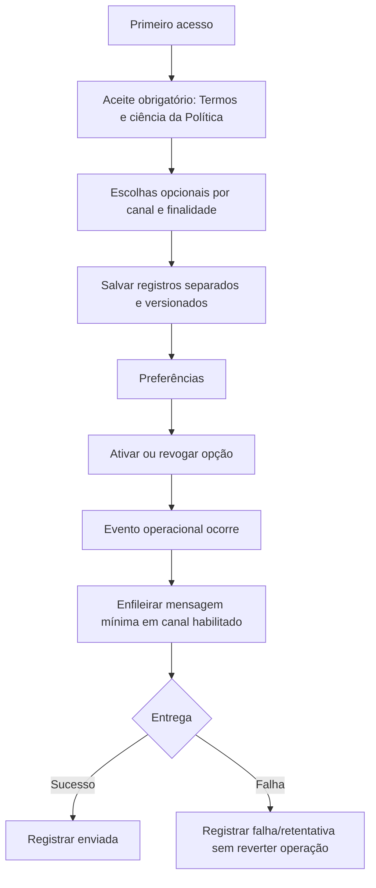

**Decisão jurídico-design a validar (DD-UX-003):** quais mensagens operacionais indispensáveis não dependem de consentimento opcional e como explicá-las.

### 7.12 Trial, planos e downgrade

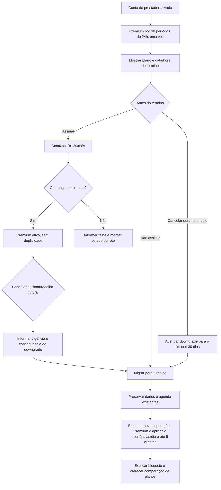

Não usar urgência artificial. Antes do downgrade, explicitar que dados Premium continuam disponíveis para leitura e quais novas operações serão bloqueadas.

## 8. Matriz de permissões percebidas

| Ação | Prestador | Cliente | Condição/feedback essencial |
|---|---:|---:|---|
| Editar próprio perfil | Sim | Sim | Perfil persistido no servidor |
| Gerar/regenerar código | Sim | Não | Avisar que o anterior será invalidado |
| Solicitar vínculo | Não | Sim | Código gera Pendente, não acesso |
| Aprovar/rejeitar pedido | Sim | Não | Somente do próprio contexto |
| Alternar prestador | Não | Sim | Apenas vínculos Ativos |
| Revogar vínculo | Sim | Sim | Preserva histórico; bloqueia novas operações |
| Gerenciar disponibilidade/serviços | Sim | Não | Restrições de plano quando aplicáveis |
| Criar atendimento | Sim | Sim | Vínculo Ativo e todas as validações |
| Remarcar/cancelar | Sob sua gestão | Apenas próprio | Somente Agendado; antecedência na remarcação |
| Concluir/marcar falta | Sim | Não | Consome reserva uma vez |
| Escrever observação compartilhada | Sim | Sim | Autor/data visíveis; não é chat |
| Registrar evolução | Sim | Não | Privada por padrão; compartilhamento explícito |
| Criar/ajustar/cancelar pacote | Sim | Não | Motivo/auditoria para ajuste |
| Consultar próprio pacote | Sim | Sim | Cliente só no vínculo correspondente |
| Gerenciar financeiro | Sim | Não | Controle manual e operacional |
| Gerenciar preferências/privacidade próprias | Sim | Sim | Por canal/finalidade |
| Contratar plano | Sim | Não | Plano pertence ao prestador |

Controles sem permissão devem ser omitidos quando nunca aplicáveis e desabilitados com explicação quando a indisponibilidade for temporária, de estado ou plano.

## 9. Estados de tela e feedback

Todas as telas de dados e ações devem especificar:

| Estado | Padrão de experiência |
|---|---|
| Inicial/carregando | esqueleto coerente; preservar cabeçalho/contexto; anunciar carregamento a tecnologia assistiva |
| Vazio | explicar o que falta e oferecer uma ação válida; nunca sugerir função sem permissão |
| Erro recuperável | causa em linguagem simples, campos preservados, ação “Tentar novamente” |
| Erro de autorização | não revelar existência de dado; orientar retorno ao contexto permitido |
| Conflito concorrente | informar que horário/saldo/cota mudou; atualizar opções sem duplicar operação |
| Offline | indicar estado global; permitir consulta apenas se houver cache seguro; não afirmar sucesso de mutação não confirmada |
| Enviando | bloquear duplo envio e manter progresso; acima de 1 s mostrar indicador |
| Sucesso | dizer o que ocorreu, novo status e próximos efeitos; separar operação de notificação |
| Parcial externo | operação concluída, comunicação/cobrança pendente ou falhou; oferecer acompanhamento apropriado |

**Decisão técnica/UX a validar (DD-UX-004):** escopo de cache e comportamento offline. A baseline exige estado offline, não autoriza criação offline.

## 10. Conteúdo, mensagens e prevenção de erros

- Preferir “Atendimento agendado” a “Operação realizada”.
- Exibir datas por extenso quando houver risco de ambiguidade e sempre indicar fuso relevante.
- Explicar “1 dia útil” antes da escolha; slots inválidos não devem ser clicáveis.
- Na recorrência, mostrar quantidade total e todas as datas antes de confirmar.
- Em cancelamento: “O horário será liberado, a reserva do pacote será devolvida e o registro ficará no histórico.”
- Em conclusão/falta: “1 unidade reservada será consumida.”
- Em vínculo: “Seu pedido foi enviado. Você terá acesso após a aprovação do prestador.”
- Em cota: “O Plano Gratuito já possui 2 agendamentos neste dia. Atendimentos existentes não serão alterados.”
- Em clientes: “O Plano Gratuito permite até 5 clientes. Os cadastros existentes não serão removidos.”
- Em notas: “Adicionar notas internas na página do cliente está disponível no Premium. Notas existentes continuam visíveis.”
- Em downgrade: “Seus dados serão preservados. Novas ações Premium ficarão indisponíveis.”
- Em falha de mensagem: “A alteração foi salva, mas a notificação ainda não foi entregue.”
- Confirmações destrutivas nomeiam a ação (“Cancelar pacote”), não usam apenas “Sim”.
- Validação ocorre no campo e no resumo; foco vai ao primeiro erro; nenhum erro depende somente de cor.
- Botão de confirmação fica protegido contra toque repetido; operações idempotentes não criam duplicatas.

**Hipótese (H-UX-002):** resumo pré-confirmação reduz erros em agendamentos sem aumentar abandono de forma relevante.

## 11. Acessibilidade e responsividade

- Atender WCAG 2.2 AA nos fluxos web críticos e requisitos mobile do RNF-ACE-001–003.
- Ordem de foco acompanha a ordem visual; modais devolvem foco ao acionador; atalhos não prendem teclado.
- Campos têm rótulos persistentes, instrução associada, propósito e erro programaticamente identificáveis.
- Status combinam texto, forma/ícone e cor; contraste mínimo aplicável; alvo de toque recomendado de 44 × 44 CSS px.
- Texto deve chegar a 200% sem perda funcional; não bloquear orientação ou zoom sem justificativa.
- Calendário possui alternativa em lista; horários e dias não dependem de leitura espacial complexa.
- Leitor de tela anuncia alteração de contexto, confirmação, saldo e resultado de validação.
- Mobile prioriza uma coluna e ações essenciais; tablet/computador usam área adicional sem mudar a sequência mental.
- Tabelas financeiras e históricas viram cartões ou lista rotulada em telas estreitas.
- Testar de 360 a 1440 px e navegadores/dispositivos definidos em RNF-COM-001–002.
- Respeitar redução de movimento e evitar temporizadores visuais curtos para decisões.

## 12. Service blueprint resumido

| Etapa | Ação do usuário | Interface | Backstage | Terceiro/evidência |
|---|---|---|---|---|
| Cadastro | escolhe perfil e aceita documentos | formulário e confirmação | Auth, perfil, consentimentos, trial | e-mail/push se habilitado; auditoria |
| Vínculo | envia código/aprova pedido | estados Pendente/Ativo | validação segura, RLS, rate limit | notificação assíncrona; log sem código |
| Agenda | escolhe slot e confirma | calendário/lista e resumo | transação de conflito, cota e saldo | confirmação enfileirada |
| Atendimento | conclui ou marca falta | detalhe e linha do tempo | transição e consumo idempotente | auditoria |
| Pacote | cria/ajusta/cancela | saldos decompostos | ledger/reservas e constraints | auditoria sem conteúdo sensível |
| Comunicação | ajusta preferências | canais/finalidades | fila, template e retentativa | WhatsApp/FCM/e-mail a definir |
| Assinatura | contrata/cancela | comparação e estado do plano | entitlement idempotente | provedor de cobrança a definir |
| Suporte a falha | tenta novamente | correlation ID amigável quando útil | logs/Sentry sem PII | alerta e reprocessamento |

## 13. Hipóteses e plano de pesquisa

| ID | Hipótese/pergunta | Método | Evidência mínima sugerida |
|---|---|---|---|
| H-UX-001 | início com agenda e pendências acelera a rotina | entrevista contextual + protótipo | 5–8 prestadores; ≥80% encontram próxima ação sem ajuda |
| H-UX-002 | resumo reduz erro de agendamento | teste moderado comparativo | redução de erro sem aumento material do abandono |
| H-UX-003 | cliente entende Pendente versus Ativo | teste de compreensão | ≥90% explicam corretamente quando terão acesso |
| H-UX-004 | seletor evita mistura entre prestadores | teste com dois vínculos | 0 ação concluída no contexto errado em tarefas críticas |
| H-UX-005 | saldos Disponível/Reservado/Consumido são compreendidos | card sorting + teste | ≥80% preveem efeito de agendar/cancelar/concluir |
| H-UX-006 | observação e evolução são distinguíveis | teste de conteúdo | ≥80% escolhem o registro adequado |
| H-UX-007 | limites de 2 ocorrências por dia e 5 clientes incentivam upgrade sem bloquear entendimento | entrevista + analytics | motivo de bloqueio entendido e conversão mensurável |
| H-UX-008 | web responsiva atende trabalho em computador | teste multidevice | fluxo Must completo nos dispositivos-alvo |

Recrutar ambos os perfis, incluir tecnologias assistivas e preservar diversidade de familiaridade digital. Não registrar dados sensíveis reais nos testes.

## 14. Métricas de UX

- taxa de conclusão de cadastro e configuração inicial;
- tempo até primeiro vínculo Ativo e primeiro agendamento;
- sucesso sem ajuda por tarefa crítica;
- taxa de erro, conflito recuperado e abandono por etapa;
- remarcações que preservam corretamente o original após falha;
- compreensão de estado de vínculo, pacote, atendimento e plano;
- tempo para registrar evolução após atendimento;
- uso do seletor por clientes multi-prestador e incidentes de contexto errado;
- falhas de comunicação interpretadas incorretamente como falha da operação;
- acessibilidade: violações críticas, conclusão por teclado/leitor e texto a 200%;
- CES após agendamento e SUS/UMUX-Lite em ciclos de validação;
- conversão do trial, upgrade após bloqueio e cancelamento, sem atribuir causalidade sem pesquisa.

Eventos analíticos devem usar identificadores técnicos e propriedades mínimas, nunca observações, documentos, códigos, tokens ou valores financeiros completos (RNF-PRI-009).

## 15. Inventário inicial de telas

| Área | Telas/componentes principais | Perfil |
|---|---|---|
| Público | landing, funcionalidades, planos, Termos, Privacidade | Todos |
| Autenticação | cadastro, escolha de perfil, login, recuperação, aceites | Ambos |
| Início | painel contextual, próximos atendimentos, pendências, alertas | Ambos, adaptado |
| Perfil | dados próprios, preferências, privacidade/direitos | Ambos |
| Vínculos | código do prestador, solicitações, adicionar código, estados, seletor | Adaptado |
| Agenda | calendário, lista, filtros, disponibilidade, detalhe | Adaptado |
| Agendamento | serviço/cliente, slot, pacote, recorrência, revisão, resultado | Adaptado |
| Clientes | lista, detalhe, histórico, animais, arquivos | Prestador |
| Serviços | lista e formulário | Prestador; consulta Cliente |
| Atendimento | detalhe, observações, evolução, anexos, estado | Adaptado |
| Pacotes | lista, detalhe, criação, ajuste, cancelamento, movimentações | Adaptado |
| Financeiro | lista, formulário, detalhe, resumo | Prestador |
| Comunicações | preferências e estado de envio suportado | Ambos |
| Planos | estado/trial/cota, comparação, contratação, cobrança/cancelamento | Prestador |
| Sistema | offline, vazio, erro, sem autorização, manutenção | Ambos |

O inventário representa superfícies, não obrigação de uma rota por item. Agrupamentos serão validados em protótipo.

## 16. Critérios de experiência

| ID | Critério verificável | Rastreabilidade |
|---|---|---|
| CE-UX-001 | Usuário identifica seu perfil e contexto ativo em telas operacionais. | RF-AUT-002–003; HU-AUT-001; HU-VIN-003 |
| CE-UX-002 | Código cria pedido Pendente e interface explica que aprovação é necessária. | RF-VIN-002–004; HU-VIN-001–002 |
| CE-UX-003 | Cliente alterna prestadores sem mistura de dados. | RF-VIN-005–006, RF-SEG-001; HU-VIN-003; HU-SEG-001 |
| CE-UX-004 | Apenas slots válidos são oferecidos e a revisão mostra fuso e antecedência. | RF-AGE-002, 005–006; HU-AGE-002–003 |
| CE-UX-005 | Falha de remarcação preserva e comunica o horário original. | RF-AGE-007–010; HU-AGE-005 |
| CE-UX-006 | Recorrência apresenta todas as ocorrências/conflitos e nunca cria parcialmente. | RF-REC-001–004; HU-REC-001 |
| CE-UX-007 | Cancelamento explica liberação de horário/reserva e preservação do histórico. | RF-CAN-001–004; HU-CAN-001 |
| CE-UX-008 | Concluir/falta informa consumo único e somente o prestador acessa a ação. | RF-ATE-001–003, RF-PAC-005; HU-ATE-001; HU-PAC-002 |
| CE-UX-009 | Pacote mostra disponível, reservado, consumido, validade e movimentações. | RF-PAC-001–008; HU-PAC-001–004 |
| CE-UX-010 | Observação é apresentada como compartilhada e evolução como técnica/privada por padrão. | RF-OBS-001–002, RF-EVO-001–002; HU-OBS-001; HU-EVO-001–002 |
| CE-UX-011 | Financeiro afirma ser manual e não sugere processamento bancário. | RF-FIN-001–004; HU-FIN-001–002 |
| CE-UX-012 | Aceites obrigatórios e consentimentos opcionais são separados e revogáveis. | RF-AUT-004, RF-COM-001; HU-COM-001 |
| CE-UX-013 | Sucesso da operação e estado da comunicação são exibidos separadamente. | RF-COM-002–004; HU-COM-002 |
| CE-UX-014 | Plano, cota e término ficam visíveis; downgrade explica preservação e bloqueios. | RF-PLN-001–007; HU-PLN-001–003 |
| CE-UX-015 | Todo fluxo Must contém loading, vazio, erro, offline e sucesso aplicáveis. | HU-MUL-001; definição de pronto; RNF-DES-004 |
| CE-UX-016 | Fluxos críticos funcionam com teclado/leitor, texto 200% e sem depender de cor. | RF-MUL-001–002; HU-MUL-001; RNF-ACE-001–003 |
| CE-UX-017 | Ações críticas usam confirmação nominal, efeitos explícitos e prevenção de duplicidade. | HU-CAN-001, HU-PAC-003–004, HU-PLN-003; RNF-DES-002 |
| CE-UX-018 | Erros de autorização e código não revelam existência de dados ou prestador. | RF-SEG-001; HU-SEG-001; RNF-VIN-003 |

## 17. Decisões e pendências para validação

1. **DD-UX-001:** padrão final de navegação por tamanho de tela.
2. **DD-UX-002:** suporte ao usuário que selecionou o perfil errado.
3. **DD-UX-003:** conteúdo jurídico e distinção visual entre comunicação indispensável e opcional.
4. **DD-UX-004:** capacidades seguras em offline e cache.
5. Formato final de uso do cliente (app instalado ou web), sem alterar paridade Must.
6. Calendário de feriados, intervalos e representação de “dia útil”.
7. Tipos, tamanhos, retenção e tratamento de anexos.
8. Provedor e estados disponíveis para WhatsApp, e-mail, push e assinatura.
9. Metas numéricas finais das métricas de UX e produto.

Até decisão formal, protótipos devem rotular esses pontos como hipótese e evitar promessas técnicas.

## 18. Coerência e limites encontrados

- O perfil “Profissional da equipe” mostrado na Lean Inception não é vigente e foi excluído deste documento.
- Comissões aparecem no mapa/sequenciador antigo da Lean Inception, mas RN-FIN-005 as exclui do MVP; não foram incluídas.
- Despesas são citadas na visão, porém RF/HU atuais detalham apenas recebimentos; a UX financeira deste documento limita-se à baseline funcional.
- A cobrança da assinatura Premium pertence ao MVP, enquanto pagamento do serviço entre cliente e prestador não é processado.
- A experiência do cliente é obrigatória e tratada como Must nos RF/HU, independentemente de redações anteriores da priorização.

## 19. Governança e backlog

O [BACKLOG central](../BACKLOG.md) é o registro operacional de decisões, hipóteses, pendências e mudanças que afetem o produto. Este documento detalha a experiência aprovada, mas não substitui o backlog.

- toda decisão `DD-UX` e hipótese `H-UX` deve possuir item correspondente no backlog;
- uma hipótese somente muda para decisão após evidência e aprovação registradas;
- mudanças aprovadas devem atualizar primeiro a fonte de verdade aplicável e depois este documento, protótipos, RF/HU e testes;
- critérios `CE-UX` devem ser relacionados aos itens de entrega e evidências de validação;
- divergências entre visão, RN, RF, HU, RNF e UX devem ser registradas antes de serem resolvidas, preservando a rastreabilidade.

### Itens UX a registrar no backlog

- `DD-UX-001` — padrão responsivo de navegação;
- `DD-UX-002` — tratamento de escolha incorreta de perfil;
- `DD-UX-003` — distinção entre comunicação indispensável e opcional;
- `DD-UX-004` — escopo seguro de cache e comportamento offline;
- `H-UX-001` a `H-UX-008` — hipóteses e pesquisas da seção 13;
- resolver as cinco divergências de baseline listadas na seção 18;
- definir estratégia do cliente (app/web), calendário de dia útil, limites de anexos, provedores e metas UX.

## 20. Histórico

| Versão | Data | Responsável | Alteração |
|---|---|---|---|
| 0.1.0 | 02/08/2026 | Dante — UX | Criação do documento de UX do MVP com personas, arquitetura da informação, jornadas, fluxos, estados, acessibilidade, blueprint, pesquisa, métricas, inventário e rastreabilidade |
| 0.2.0 | 02/08/2026 | Nero — UI e Design System | Vinculação da baseline de UX ao Design System v0.1.0, sem alteração dos fluxos ou requisitos funcionais |
| 0.2.1 | 02/08/2026 | Nero — UI e Design System | Atualização da referência para Design System v0.2.0 e seu catálogo universal de ícones, sem alterar fluxos |
