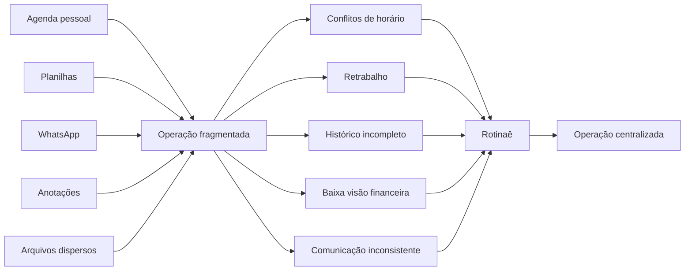
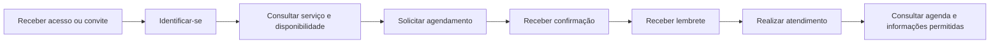
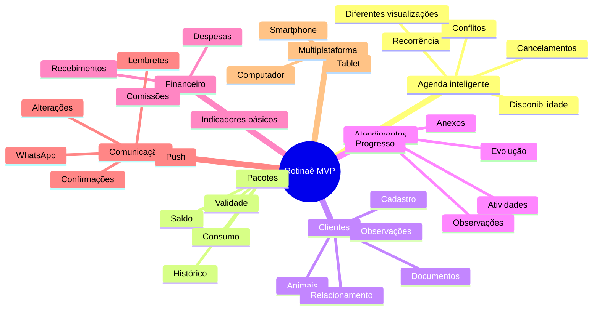
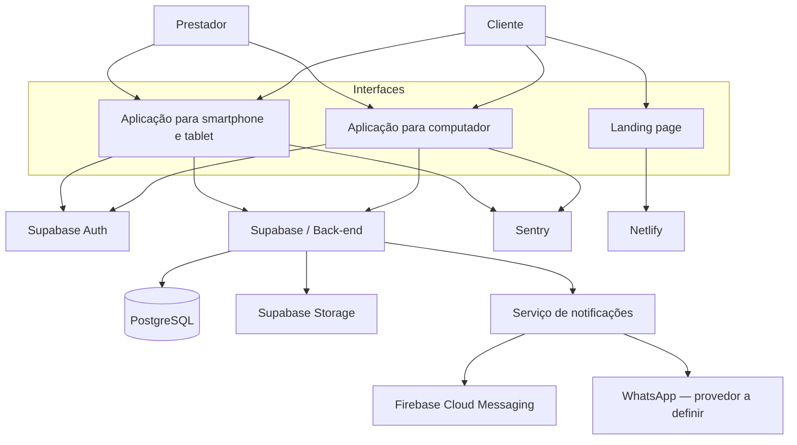
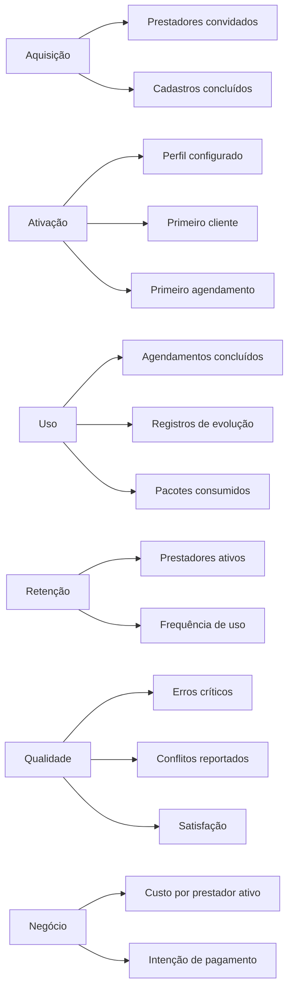
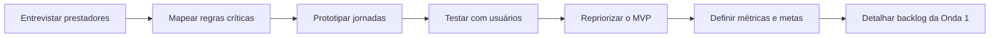

# Lean Inception Visual — Rotinaê

> **Versão:** 0.3.0  
> **Status:** Base para alinhamento e validação  
> **Data:** 2 de agosto de 2026  
> **Documento de origem:** [Documento de Visão do Produto — v0.4.0](./VISAO_DO_PRODUTO.md)  
> **Regras vigentes:** [Regras de Negócio do MVP — v0.2.0](./REGRAS_DE_NEGOCIO_MVP.md)
> **Governança:** [Backlog e Registro de Decisões](../BACKLOG.md)

## Visão do produto

> Para **prestadores de serviços**, inicialmente adestradores,  
> que precisam **organizar atendimentos, clientes e sua operação**,  
> o **Rotinaê** é uma **plataforma multiplataforma de gestão de serviços**  
> que centraliza **agenda, pacotes, evolução dos atendimentos, finanças e comunicação**.  
> Diferentemente do uso combinado de agendas, planilhas, mensagens e anotações,  
> o produto oferece **uma operação integrada, rastreável e acessível em diferentes dispositivos**.

## O problema em uma imagem

## Objetivos do produto

| Objetivo | Resultado esperado |
|---|---|
| Organizar a agenda | Menos conflitos, esquecimentos e tempo gasto com organização manual |
| Centralizar o relacionamento | Dados, documentos e histórico disponíveis em um único lugar |
| Controlar pacotes | Saldo, validade e consumo rastreáveis |
| Registrar a evolução | Progresso de cada serviço documentado ao longo do tempo |
| Dar visibilidade financeira | Recebimentos e indicadores básicos acessíveis |
| Automatizar a comunicação | Confirmações e lembretes enviados pelos canais definidos |
| Permitir acesso multiplataforma | Experiência consistente em smartphones, tablets e computadores |
| Validar um núcleo reutilizável | Produto testado com adestradores e preparado para outros segmentos |

## Personas iniciais

| Persona | Necessidades | Dores | Valor esperado |
|---|---|---|---|
| **Prestador autônomo** | Organizar agenda, clientes, serviços e finanças | Ferramentas dispersas, tarefas manuais e pouca previsibilidade | Controle da operação em um só lugar |
| **Cliente final** | Consultar e acompanhar seus agendamentos | Informações perdidas em conversas e lembretes inconsistentes | Jornada simples e comunicação clara |
| **Profissional da equipe** | Consultar agenda e registrar atendimentos | Informações incompletas e processos diferentes | Contexto e registro acessíveis conforme permissão |

> No lançamento existirão dois perfis: Prestador e Cliente. O trabalho com equipes permanece como hipótese futura.

## Jornadas principais

### Jornada do prestador

```mermaid
flowchart LR
    A[Criar conta] --> B[Configurar perfil]
    B --> C[Cadastrar serviços e pacotes]
    C --> D[Cadastrar cliente e animal]
    D --> E[Definir disponibilidade]
    E --> F[Agendar atendimento]
    F --> G[Enviar confirmação]
    G --> H[Realizar atendimento]
    H --> I[Registrar evolução]
    I --> J[Consumir saldo do pacote]
    J --> K[Registrar recebimento]
    K --> L[Acompanhar histórico e indicadores]
```

### Jornada do cliente

> O cliente escolherá seu perfil no acesso e informará o código do prestador para realizar o vínculo. Ainda será definido se utilizará aplicativo instalado ou interface web.

## Mapa de funcionalidades

## É / Não é / Faz / Não faz

| **É** | **Não é** |
|---|---|
| Plataforma SaaS de gestão de atendimentos | Marketplace público de prestadores |
| Multiplataforma | Sistema contábil, fiscal ou bancário completo |
| Inicialmente orientada a adestradores | Produto exclusivo e rígido para adestramento |
| Núcleo modular para prestadores de serviços | Automação autônoma baseada em IA |

| **Faz no MVP** | **Não faz no MVP** |
|---|---|
| Agenda, disponibilidade e recorrência | Roteirização avançada em tempo real |
| Clientes, documentos, animais e histórico | Videochamada nativa |
| Pacotes, saldo, validade e consumo | Sincronização bidirecional completa com calendários |
| Evolução dos atendimentos e anexos | Automações avançadas de marketing |
| Controle financeiro operacional | Gestão contábil ou fiscal completa |
| Lembretes, notificações e WhatsApp | Integrações simultâneas com vários meios de pagamento |

## Sequenciador do MVP

```mermaid
flowchart LR
    subgraph O1[Onda 1 — Fundamentos]
        A[Autenticação e perfis]
        B[Clientes e animais]
        C[Serviços]
        D[Agenda e disponibilidade]
    end

    subgraph O2[Onda 2 — Operação]
        E[Recorrência]
        F[Pacotes e saldo]
        G[Evolução dos atendimentos]
        H[Documentos e anexos]
    end

    subgraph O3[Onda 3 — Controle]
        I[Recebimentos e despesas]
        J[Comissões]
        K[Indicadores básicos]
    end

    subgraph O4[Onda 4 — Comunicação e validação]
        L[Lembretes automáticos]
        M[WhatsApp e push]
        N[Experiência do cliente]
        O[Métricas e monitoramento]
    end

    O1 --> O2 --> O3 --> O4
```

> O sequenciamento representa uma proposta de dependência e aprendizado, não um cronograma fechado. Cada onda deve gerar uma versão utilizável e validável.

## Priorização MoSCoW

| Prioridade | Capacidades |
|---|---|
| **Must — indispensável** | autenticação; perfis; clientes; animais; serviços; agenda; disponibilidade; recorrência; pacotes; saldo e consumo; evolução dos atendimentos; controle de acesso; experiência responsiva |
| **Should — importante** | documentos e anexos; indicadores básicos; canais adicionais; filtros e relatórios adicionais |
| **Could — desejável** | despesas avançadas e personalizações não essenciais |
| **Won't now — não agora** | marketplace; contabilidade completa; roteirização avançada; videochamadas; marketing avançado; personalizações profundas |

> **A validar em workshop:** a separação entre Must e Should deve ser confrontada com prazo, orçamento, entrevistas e protótipos. Todas as capacidades listadas continuam pertencendo à visão atual do MVP, mas poderão ser entregues incrementalmente.

## Arquitetura visual inicial

> **Decisão técnica pendente:** validar a estratégia web para computadores e o grau de compartilhamento de código com React Native/Expo.

## Indicadores de sucesso

Os valores-alvo devem ser definidos depois da pesquisa inicial e da criação de uma linha de base.

## Riscos e respostas

| Risco | Sinal de alerta | Resposta inicial |
|---|---|---|
| Escopo amplo | Muitas frentes sem fluxo completo utilizável | Entregar por ondas verticais e validar cada uma |
| Generalização prematura | Regras abstratas sem demanda real | Priorizar os fluxos reais de adestradores |
| Complexidade da recorrência | Exceções e alterações inconsistentes | Mapear cenários e regras antes do desenvolvimento |
| Dados financeiros incorretos | Divergência entre lançamentos e operação | Definir regras, auditoria e testes de cálculo |
| Exposição de documentos | Usuário acessa arquivo de outro prestador | Aplicar autorização e políticas de armazenamento desde o início |
| WhatsApp inviável ou caro | Templates reprovados ou custo elevado | Validar provedor, consentimento, política e alternativa de canal |
| Experiência desigual entre dispositivos | Fluxo funciona bem apenas em uma tela | Testar protótipos responsivos antes de consolidar a tecnologia |

## Hipóteses prioritárias para validação

1. Adestradores percebem valor suficiente na centralização para trocar suas ferramentas atuais.
2. Agenda, clientes e pacotes formam o núcleo mínimo que gera uso recorrente.
3. O registro de evolução é utilizado durante ou logo após cada atendimento.
4. A gestão financeira básica reduz controles paralelos em planilhas.
5. Lembretes por WhatsApp reduzem faltas e trabalho manual.
6. Uma experiência web responsiva atende adequadamente o uso em computadores.
7. Prestadores demonstram disposição para pagar por uma assinatura recorrente.

## Decisões pendentes

| Tema | Pergunta que precisa ser respondida |
|---|---|
| Agenda | Como serão tratados feriados, duração, intervalos, fuso horário e conflitos simultâneos? |
| Vínculo | O código cria vínculo imediato ou exige aprovação? Um cliente pode ter vários prestadores? |
| Recorrência | Quais frequências, limites e tratamentos de indisponibilidade serão permitidos? |
| Pacotes | O que ocorre com saldo e atendimentos futuros após vencimento ou cancelamento? |
| Financeiro | Quais categorias e indicadores adicionais serão necessários após a validação básica? |
| Cliente | Ele usará aplicativo instalado ou interface web e quais dados poderá consultar? |
| Arquivos | Quais formatos, tamanhos, prazos de retenção e permissões serão aceitos? |
| WhatsApp | Qual provedor oficial, consentimento e modelos de mensagem serão adotados? |
| Multiplataforma | Qual solução web será usada e quanto código será compartilhado? |
| Planos | Validar os limites do Gratuito: 2 agendamentos por dia, até 5 clientes e sem novas notas internas na página do cliente. |
| Assinatura | Qual mecanismo realizará a cobrança do Premium de R$ 29,00/mês após o teste de 30 dias? |
| Sucesso | Quais metas numéricas determinarão a validação do MVP? |

## Próximos passos da inception

## Histórico de alterações

| Versão | Data | Responsável | Alteração |
|---|---|---|---|
| 0.1.0 | 02/08/2026 | Equipe Rotinaê | Criação da Lean Inception visual baseada no Documento de Visão v0.2.0 |
| 0.2.0 | 02/08/2026 | Equipe Rotinaê | Sincronização com as regras de negócio, perfis, vínculo por código e estratégia de planos da Visão v0.3.0 |
| 0.3.0 | 02/08/2026 | Equipe Rotinaê | Incorporação da revisão multidisciplinar e sincronização com RN v0.2.0, RF, RNF e histórias de usuário |
